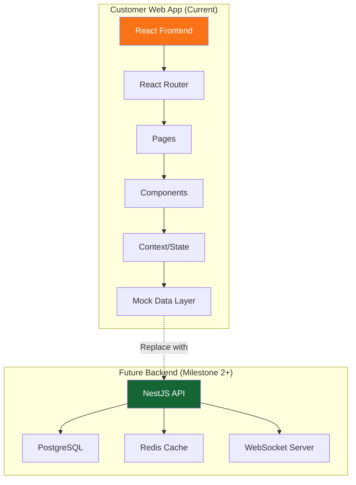

# KhaanaDa — Cravings Delivered 🍽️

**Pakistan's Food Delivery Platform**

[]()
[]()
[]()
[]()
[]()

---

## 📋 Overview

**KhaanaDa** is a multi-vendor food delivery platform designed for the Pakistani market. This repository contains the **Customer Web Application** — the first milestone of a comprehensive platform that will include restaurant partner portals, rider applications, and admin dashboards.

### Current Implementation Status

✅ **Customer Web Application** (Milestone 1 - Complete)
- Restaurant discovery and search
- Menu browsing with categories
- Shopping cart management
- Checkout flow with COD (Cash on Delivery)
- Order tracking
- User authentication (demo mode)
- Profile management
- Bilingual support (English/Urdu)
- RTL layout support
- Responsive design (mobile-first)
- Pakistan-specific features (PKR currency, local restaurants)

⚠️ **Demo Mode** - Current implementation uses mock data and simulated authentication. Backend integration required for production.

### Planned Features

🔄 **Milestone 2** - Backend API & Database Integration
🔄 **Milestone 3** - Secure Authentication & Persistent Orders
🔄 **Milestone 4** - Restaurant Partner Portal
🔄 **Milestone 5** - Rider Application & Delivery Operations
🔄 **Milestone 6** - Admin Dashboard
🔄 **Milestone 7** - Payment Integrations (JazzCash, easypaisa, Raast)

---

## 🛠️ Technology Stack

### Frontend
- **Framework**: React 18.2 with TypeScript
- **Build Tool**: Vite 6.3
- **Styling**: Tailwind CSS 4.1
- **Routing**: React Router DOM 6.8
- **State Management**: React Context API
- **Icons**: Lucide React
- **Animations**: Framer Motion
- **Charts**: Recharts (for future admin dashboard)

### Development Tools
- TypeScript 5.7
- ESLint (configured)
- Vite for fast HMR and builds

### Planned Backend (Milestone 2)
- **API**: NestJS with TypeScript
- **Database**: PostgreSQL with PostGIS
- **ORM**: Prisma
- **Cache**: Redis
- **Authentication**: JWT with refresh tokens
- **Real-time**: WebSockets for order tracking

---

## 🏗️ Architecture Overview



### Current Data Flow
1. User interacts with React components
2. State managed via React Context (`AppContext`)
3. Mock data loaded from `src/data/index.ts`
4. Cart and orders stored in memory (lost on refresh)
5. Authentication simulated (no real credentials)

### Future Data Flow (After Backend Integration)
1. User interacts with React components
2. API calls to NestJS backend
3. Backend validates and processes requests
4. Data persisted in PostgreSQL
5. Real-time updates via WebSockets
6. Secure authentication with JWT tokens

---

## 📁 Project Structure

```
khaanada/
├── src/
│   ├── components/          # Reusable UI components
│   │   ├── Header.tsx       # Navigation header
│   │   ├── Footer.tsx       # Site footer
│   │   ├── CartDrawer.tsx   # Shopping cart sidebar
│   │   ├── MobileNav.tsx    # Mobile bottom navigation
│   │   └── ScrollToTop.tsx  # Scroll restoration
│   ├── context/
│   │   └── AppContext.tsx   # Global state management
│   ├── data/
│   │   └── index.ts        # Mock data (restaurants, menu items)
│   ├── pages/
│   │   ├── HomePage.tsx           # Landing page
│   │   ├── RestaurantsPage.tsx    # Restaurant listing
│   │   ├── RestaurantDetailPage.tsx # Menu & details
│   │   ├── CheckoutPage.tsx       # Order checkout
│   │   ├── OrdersPage.tsx         # Order history
│   │   ├── LoginPage.tsx          # Authentication
│   │   ├── ProfilePage.tsx        # User profile
│   │   ├── PartnerPage.tsx        # Partner registration
│   │   └── NotFoundPage.tsx       # 404 page
│   ├── types/
│   │   └── index.ts        # TypeScript interfaces
│   ├── App.tsx             # Main app component & routing
│   ├── main.tsx            # Entry point
│   └── index.css           # Global styles & Tailwind
├── docs/                   # Documentation
│   ├── BUILD_STATUS.md
│   ├── CHANGELOG.md
│   ├── architecture/
│   ├── development/
│   └── guides/
├── public/                 # Static assets
├── index.html             # HTML template
├── package.json           # Dependencies & scripts
├── tsconfig.json          # TypeScript config
├── vite.config.js         # Vite configuration
└── README.md              # This file
```

---

## 🚀 Quick Start

### Prerequisites
- **Node.js**: 18.x or higher
- **npm**: 9.x or higher
- **Git**: For version control

### Installation

```bash
# Clone the repository
git clone https://github.com/AtifBukhai/FoodApp.git
cd FoodApp

# Install dependencies
npm install

# Start development server
npm run dev
```

The application will be available at `http://localhost:5173`

### Build for Production

```bash
# Type check
npm run typecheck

# Build
npm run build

# Preview production build
npm run preview
```

---

## 📖 Available Routes

| Route | Page | Description |
|-------|------|-------------|
| `/` | Home | Landing page with featured restaurants |
| `/restaurants` | Restaurants | Browse all restaurants with filters |
| `/restaurant/:id` | Restaurant Detail | View menu and restaurant info |
| `/checkout` | Checkout | Review cart and place order |
| `/orders` | Orders | Order history and tracking |
| `/login` | Login | User authentication |
| `/profile` | Profile | User settings and addresses |
| `/partner` | Partner | Restaurant/rider registration info |
| `*` | 404 | Not found page |

---

## 🎨 Design System

### Color Palette
- **Primary Orange**: `#F97316` - Call-to-action, highlights
- **Deep Green**: `#166534` - Brand identity, success states
- **Cream**: `#FFF8F0` - Background, cards
- **Brown**: `#78350F` - Text accents

### Typography
- **Primary Font**: Inter (Latin/English)
- **Urdu Font**: Noto Nastaliq Urdu
- **Headings**: Bold, 800 weight
- **Body**: Regular, 400 weight

### Components
- Rounded corners (xl, 2xl)
- Subtle shadows for depth
- Hover effects with smooth transitions
- Mobile-first responsive design
- RTL support for Urdu language

---

## 🌐 Features & Functionality

### ✅ Implemented Features

#### Restaurant Discovery
- Browse restaurants by cuisine category
- Search by name, cuisine, or dish
- Filter by rating, delivery time, price
- Sort options (rating, delivery time, price)
- Restaurant cards with ratings, delivery info

#### Menu Browsing
- Category-based menu organization
- Item details (description, price, dietary info)
- Vegetarian/vegan/spicy indicators
- Popular item badges
- Availability status
- Add to cart with quantity controls

#### Shopping Cart
- Slide-out cart drawer
- Quantity adjustment
- Item removal
- Real-time price calculation
- Subtotal, delivery fee, tax breakdown

#### Checkout
- Address selection (saved addresses)
- Payment method selection (COD/Online)
- Order summary
- Order confirmation
- Estimated delivery time

#### Order Management
- Order history
- Order status tracking
- Timeline visualization
- Reorder functionality
- Order details view

#### User Features
- Login/Register (demo mode)
- Profile management
- Saved addresses
- Language preference (EN/UR)
- Order history

#### Localization
- English language support
- Urdu language support (اردو)
- RTL layout for Urdu
- Localized content throughout

### ⚠️ Demo-Only Features (Not Production-Ready)

1. **Authentication**: Simulated login, no real credential validation
2. **Order Persistence**: Orders stored in memory, lost on page refresh
3. **User Data**: No real user accounts or data persistence
4. **Payment Processing**: COD only, online payment not integrated
5. **Address Validation**: No real geocoding or delivery zone validation
6. **Restaurant Data**: Mock data, not connected to real restaurants
7. **Price Calculation**: Frontend only, no server-side validation
8. **Order Status Updates**: Static, no real-time tracking

---

## 🔒 Security Considerations

### Current State (Demo Mode)
- ❌ No real authentication
- ❌ No data encryption
- ❌ No CSRF protection
- ❌ No rate limiting
- ❌ No input sanitization
- ❌ No secure session management

### Required for Production (Milestone 2+)
- ✅ JWT-based authentication with refresh tokens
- ✅ Password hashing (Argon2id)
- ✅ HTTPS enforcement
- ✅ CSRF tokens
- ✅ Rate limiting
- ✅ Input validation & sanitization
- ✅ SQL injection prevention (parameterized queries)
- ✅ XSS protection
- ✅ Secure headers (CSP, HSTS, etc.)
- ✅ Session management
- ✅ API key protection
- ✅ Webhook signature verification

---

## 🧪 Testing

### Current Testing Status
- ⚠️ No automated tests implemented yet
- ✅ Manual testing performed during development
- ✅ Build verification passing

### Planned Testing Strategy (Milestone 2+)
- Unit tests (Jest/Vitest)
- Component tests (React Testing Library)
- Integration tests (API endpoints)
- E2E tests (Playwright/Cypress)
- Security testing (OWASP guidelines)

---

## 📚 Documentation

Comprehensive documentation is available in the `docs/` directory:

- **[Build Status](docs/BUILD_STATUS.md)** - Current implementation status and known issues
- **[Changelog](docs/CHANGELOG.md)** - Version history and changes
- **[System Overview](docs/architecture/system-overview.md)** - Architecture details
- **[Local Setup](docs/development/local-setup.md)** - Development environment setup
- **[Testing Guide](docs/development/testing-guide.md)** - Testing procedures
- **[Customer User Guide](docs/guides/customer-user-guide.md)** - How to use the app
- **[Troubleshooting](docs/guides/troubleshooting-guide.md)** - Common issues and solutions

---

## 🗺️ Roadmap

### Milestone 1: Customer Web App ✅ (Current)
- [x] Restaurant discovery
- [x] Menu browsing
- [x] Shopping cart
- [x] Checkout flow
- [x] Order tracking
- [x] User authentication (demo)
- [x] Bilingual support
- [x] Responsive design

### Milestone 2: Backend API & Database 🔄 (Next)
- [ ] NestJS API setup
- [ ] PostgreSQL database with Prisma
- [ ] Restaurant catalog API
- [ ] User authentication API
- [ ] Order management API
- [ ] API documentation (OpenAPI)
- [ ] Frontend API integration

### Milestone 3: Secure Authentication
- [ ] JWT implementation
- [ ] Password hashing (Argon2id)
- [ ] Email verification
- [ ] Password recovery
- [ ] Session management
- [ ] Security headers

### Milestone 4: Restaurant Partner Portal
- [ ] Restaurant registration
- [ ] Menu management
- [ ] Order acceptance/rejection
- [ ] Sales dashboard
- [ ] Staff management

### Milestone 5: Rider Application
- [ ] Rider registration
- [ ] Order assignment
- [ ] Delivery tracking
- [ ] Earnings dashboard
- [ ] Location services

### Milestone 6: Admin Dashboard
- [ ] User management
- [ ] Restaurant approval
- [ ] Order monitoring
- [ ] Analytics & reporting
- [ ] System configuration

### Milestone 7: Payment & Notifications
- [ ] JazzCash integration
- [ ] easypaisa integration
- [ ] Raast integration
- [ ] Email notifications
- [ ] SMS notifications
- [ ] Push notifications

---

## 🤝 Contributing

This is currently a solo development project. For collaboration inquiries, please contact the repository owner.

### Development Guidelines
1. Follow TypeScript best practices
2. Use functional components with hooks
3. Maintain component reusability
4. Keep state management simple (Context API for now)
5. Write clear, descriptive commit messages
6. Test thoroughly before committing
7. Update documentation for significant changes

---

## 📄 License

This project is proprietary software. All rights reserved.

---

## 📞 Support

For questions or issues:
- **GitHub Issues**: Report bugs and feature requests
- **Documentation**: Check `docs/` directory
- **Email**: Contact repository owner

---

## 🙏 Acknowledgments

- **React Team** - For the amazing framework
- **Vite Team** - For the fast build tool
- **Tailwind CSS** - For the utility-first CSS framework
- **Lucide** - For the beautiful icons
- **Pakistani Food Community** - For inspiration

---

## 📊 Project Status

| Metric | Status |
|--------|--------|
| Build | ✅ Passing |
| Type Check | ✅ Passing |
| Customer App | ✅ Complete (Demo) |
| Backend API | ⏳ Planned |
| Authentication | ⚠️ Demo Only |
| Payment Integration | ⏳ Planned |
| Documentation | ✅ Complete |
| Tests | ⏳ Planned |

---

**Built with ❤️ for Pakistan**

*KhaanaDa — Cravings Delivered.* 🍛🚀
