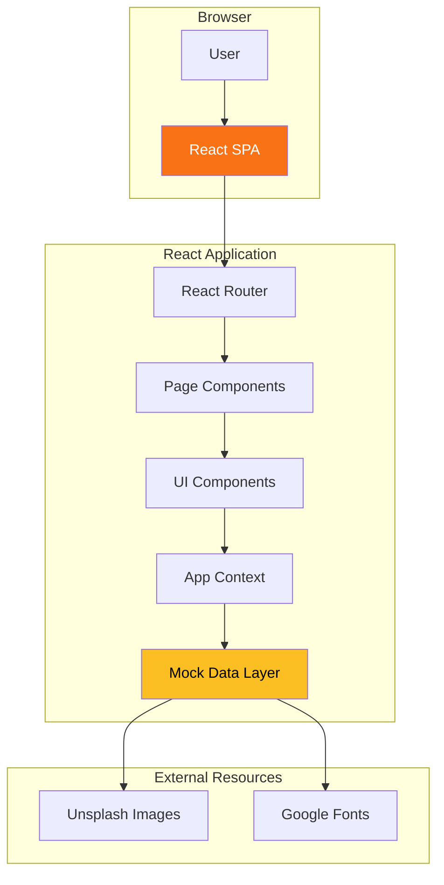
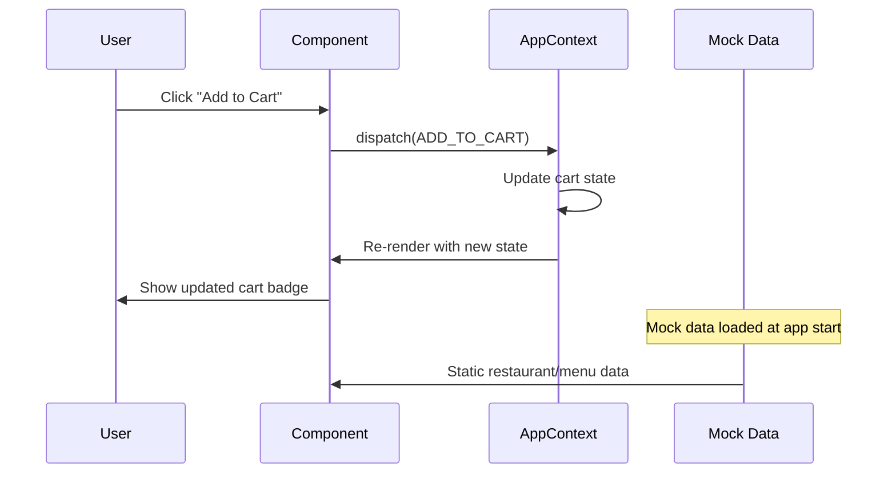
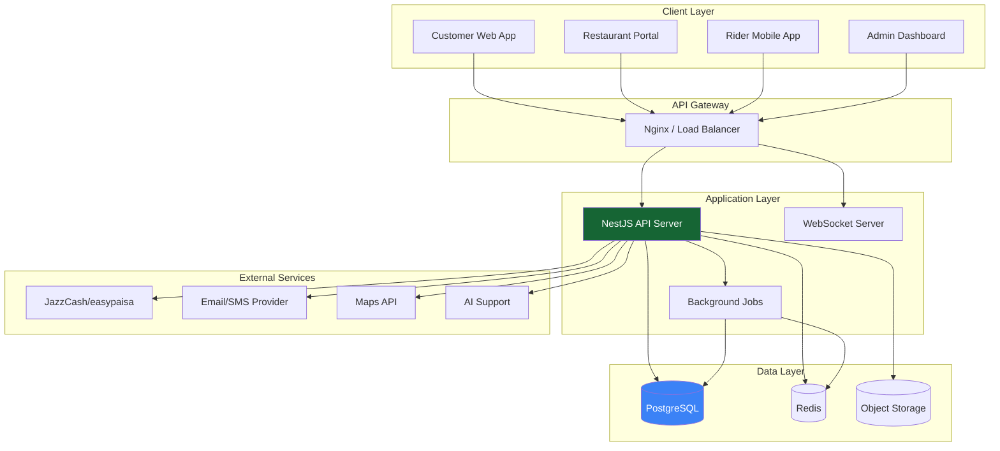
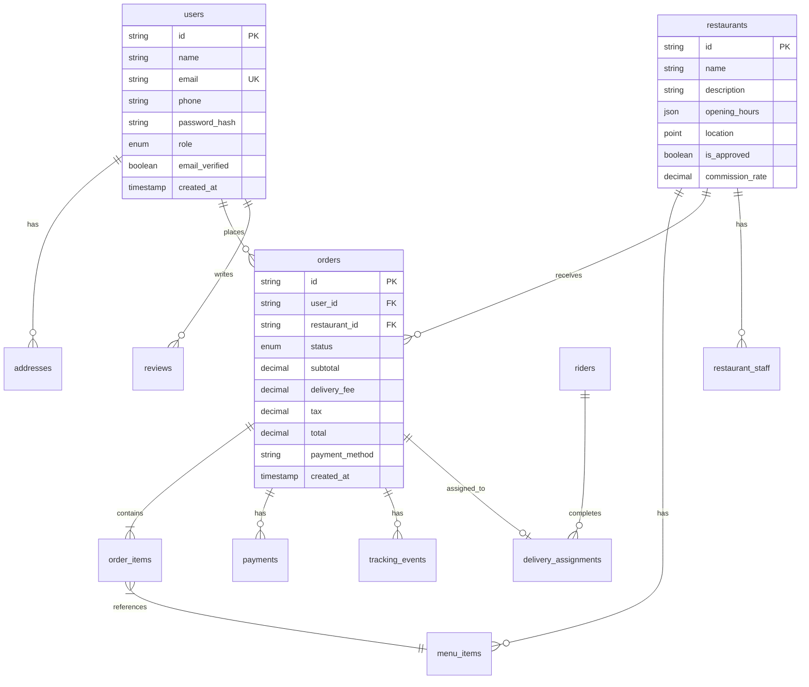
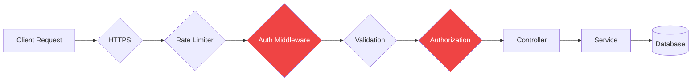
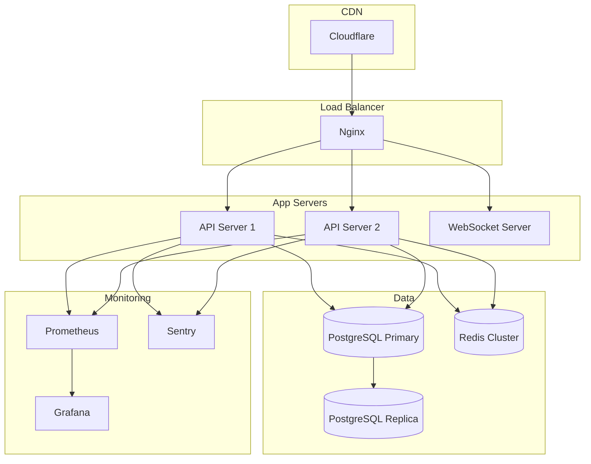

# KhaanaDa — System Architecture Overview

**Version**: 0.1.0
**Last Updated**: 2024-01-16

---

## Executive Summary

KhaanaDa is a multi-vendor food delivery platform for the Pakistani market. The current implementation (v0.1.0) is a **customer-facing web application** built with React, TypeScript, and Tailwind CSS. This document describes the current architecture and the planned evolution toward a full-stack platform.

---

## Current Architecture (v0.1.0)

### Overview



### Technology Stack

| Layer | Technology | Purpose |
|-------|-----------|---------|
| UI Framework | React 18.2 | Component-based UI |
| Language | TypeScript 5.7 | Type safety |
| Build Tool | Vite 6.3 | Fast builds & HMR |
| Styling | Tailwind CSS 4.1 | Utility-first CSS |
| Routing | React Router DOM 6.8 | Client-side routing |
| State | React Context API | Global state management |
| Icons | Lucide React | SVG icon library |
| Animation | Framer Motion | UI animations |

### Application Structure

```
src/
├── App.tsx              # Root component, routing config
├── main.tsx             # Entry point, React DOM render
├── index.css            # Global styles, Tailwind directives
│
├── components/          # Reusable UI components
│   ├── Header.tsx       # Top navigation bar
│   ├── Footer.tsx       # Site footer
│   ├── CartDrawer.tsx   # Shopping cart sidebar
│   ├── MobileNav.tsx    # Mobile bottom navigation
│   └── ScrollToTop.tsx  # Scroll restoration
│
├── pages/               # Route-level page components
│   ├── HomePage.tsx
│   ├── RestaurantsPage.tsx
│   ├── RestaurantDetailPage.tsx
│   ├── CheckoutPage.tsx
│   ├── OrdersPage.tsx
│   ├── LoginPage.tsx
│   ├── ProfilePage.tsx
│   ├── PartnerPage.tsx
│   └── NotFoundPage.tsx
│
├── context/
│   └── AppContext.tsx   # Global state (cart, user, orders)
│
├── data/
│   └── index.ts        # Mock data (restaurants, menus)
│
└── types/
    └── index.ts        # TypeScript interfaces
```

### State Management

The application uses React Context API for global state management:

```typescript
interface AppState {
  language: 'en' | 'ur';     // Current language
  cart: CartItem[];          // Shopping cart items
  cartOpen: boolean;         // Cart drawer visibility
  user: User | null;         // Current user (demo)
  orders: Order[];           // Order history
  addresses: Address[];      // Saved addresses
  notification: {...} | null; // Toast notification
}
```

**State Actions**:
- `SET_LANGUAGE` — Toggle between English and Urdu
- `ADD_TO_CART` — Add item to shopping cart
- `REMOVE_FROM_CART` — Remove item from cart
- `UPDATE_QUANTITY` — Change item quantity
- `CLEAR_CART` — Empty the cart
- `TOGGLE_CART` — Open/close cart drawer
- `SET_USER` — Set/clear current user
- `ADD_ORDER` — Add new order to history
- `ADD_ADDRESS` — Save new address
- `REMOVE_ADDRESS` — Delete saved address
- `SET_NOTIFICATION` — Show/hide toast notification

### Data Flow



### Routing

| Path | Component | Description |
|------|-----------|-------------|
| `/` | `HomePage` | Landing page |
| `/restaurants` | `RestaurantsPage` | Browse restaurants |
| `/restaurant/:id` | `RestaurantDetailPage` | Restaurant menu |
| `/checkout` | `CheckoutPage` | Place order |
| `/orders` | `OrdersPage` | Order history |
| `/login` | `LoginPage` | Authentication |
| `/profile` | `ProfilePage` | User settings |
| `/partner` | `PartnerPage` | Partner info |
| `*` | `NotFoundPage` | 404 error |

### Current Limitations

1. **No Backend**: All data is mock/seed data
2. **No Persistence**: State lost on page refresh
3. **No Real Auth**: Login is simulated
4. **No Real Payments**: COD is simulated
5. **No Real Orders**: Orders exist only in memory
6. **No Real-Time**: No WebSocket connections
7. **No File Upload**: No image upload capability
8. **No Geocoding**: No real address validation

---

## Planned Architecture (v0.2.0+)

### Target Architecture



### Backend Stack (Planned)

| Component | Technology | Purpose |
|-----------|-----------|---------|
| API Framework | NestJS | RESTful API |
| Database | PostgreSQL | Primary data store |
| Spatial Data | PostGIS | Location & delivery zones |
| ORM | Prisma | Database access |
| Cache | Redis | Session cache, rate limiting |
| Auth | JWT + Refresh Tokens | Secure authentication |
| Passwords | Argon2id | Password hashing |
| Real-time | WebSocket | Order tracking |
| Jobs | Bull Queue | Background processing |
| Storage | S3-compatible | Image uploads |
| Email | Nodemailer + SMTP | Transactional email |
| SMS | Twilio/local provider | OTP and notifications |
| Maps | Google Maps/OSM | Geocoding, routing |
| Payments | JazzCash/easypaisa | Online payments |

### Database Schema (Planned)



### API Endpoints (Planned)

#### Authentication
- `POST /api/auth/register` — Register new user
- `POST /api/auth/login` — Login
- `POST /api/auth/refresh` — Refresh token
- `POST /api/auth/logout` — Logout
- `POST /api/auth/forgot-password` — Password recovery
- `POST /api/auth/verify-email` — Email verification

#### Restaurants
- `GET /api/restaurants` — List restaurants (with filters)
- `GET /api/restaurants/:id` — Get restaurant details
- `GET /api/restaurants/:id/menu` — Get menu items
- `GET /api/categories` — List cuisine categories

#### Orders
- `POST /api/orders` — Place new order
- `GET /api/orders` — Get user's orders
- `GET /api/orders/:id` — Get order details
- `PATCH /api/orders/:id/cancel` — Cancel order
- `GET /api/orders/:id/tracking` — Get tracking events

#### Cart & Checkout
- `POST /api/cart/calculate` — Calculate totals server-side
- `POST /api/checkout/validate` — Validate order before placement

#### User Profile
- `GET /api/users/me` — Get current user
- `PATCH /api/users/me` — Update profile
- `GET /api/users/me/addresses` — Get addresses
- `POST /api/users/me/addresses` — Add address
- `DELETE /api/users/me/addresses/:id` — Remove address

### Security Architecture (Planned)



**Security Layers**:
1. HTTPS enforcement
2. Rate limiting (per IP, per user)
3. JWT authentication
4. Input validation (class-validator)
5. Role-based authorization
6. SQL injection prevention (Prisma)
7. XSS prevention (output encoding)
8. CSRF protection (tokens)
9. Secure headers (Helmet.js)
10. Audit logging

---

## Deployment Architecture (Planned)



---

## Performance Considerations

### Current (v0.1.0)
- Bundle size: 281KB JS (78KB gzipped)
- CSS: 37KB (7.4KB gzipped)
- No code splitting (single bundle)
- No lazy loading
- Images from external CDN (Unsplash)

### Planned Optimizations
- Route-based code splitting
- Lazy loading for images
- Service worker for offline support
- CDN for static assets
- Image optimization pipeline
- API response caching
- Database query optimization
- Connection pooling

---

## Scalability Considerations

### Current Limitations
- Single-page application
- No server-side rendering
- In-memory state only
- No caching layer
- No horizontal scaling

### Planned Scalability
- Horizontal API scaling
- Database read replicas
- Redis caching layer
- CDN for static assets
- Background job processing
- Horizontal WebSocket scaling
- Microservices (if needed)

---

## Related Documentation

- [API Reference](api-reference.md) — Planned API documentation
- [Database Schema](database-schema.md) — Planned database design
- [Local Setup](../development/local-setup.md) — Development environment
- [Build Status](../BUILD_STATUS.md) — Current implementation status

---

**Document Version**: 1.0.0
**Architecture Version**: 0.1.0 (Current), 0.2.0 (Planned)
